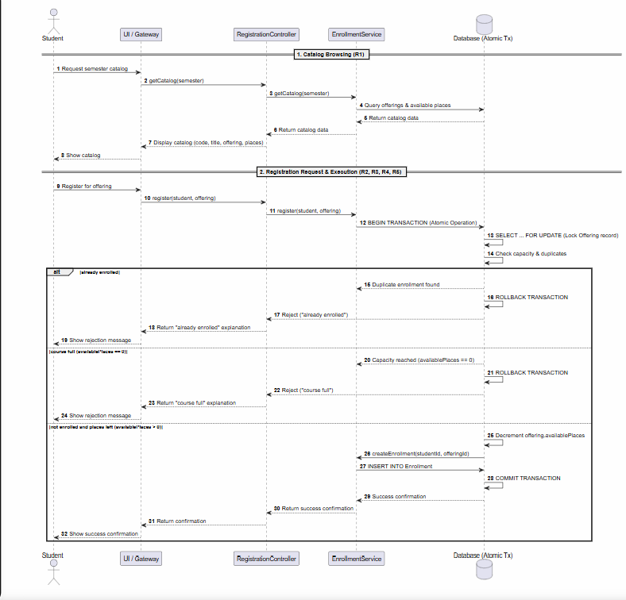
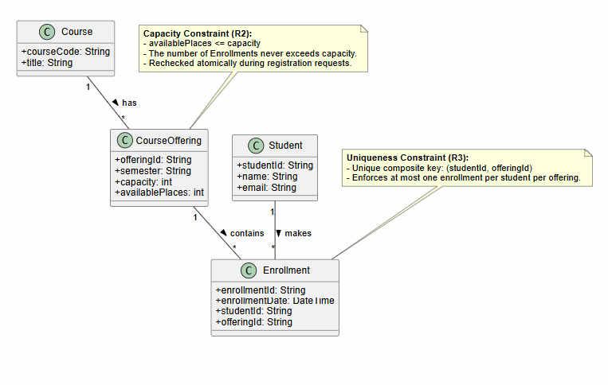
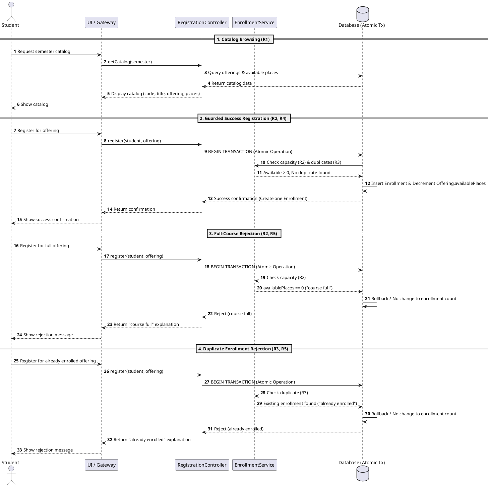
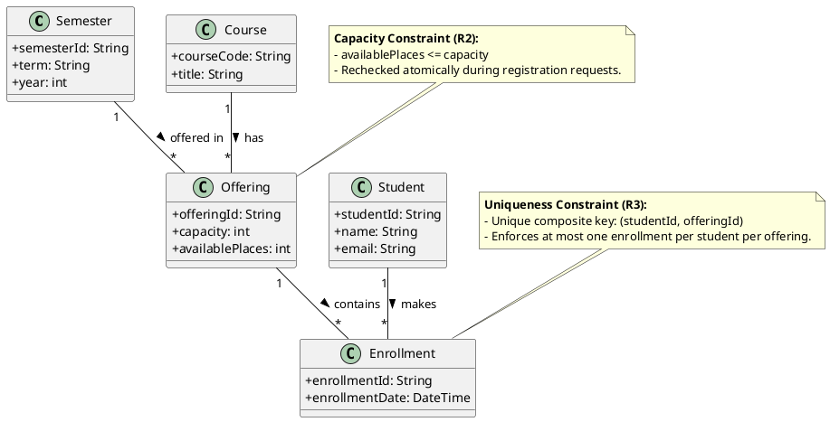
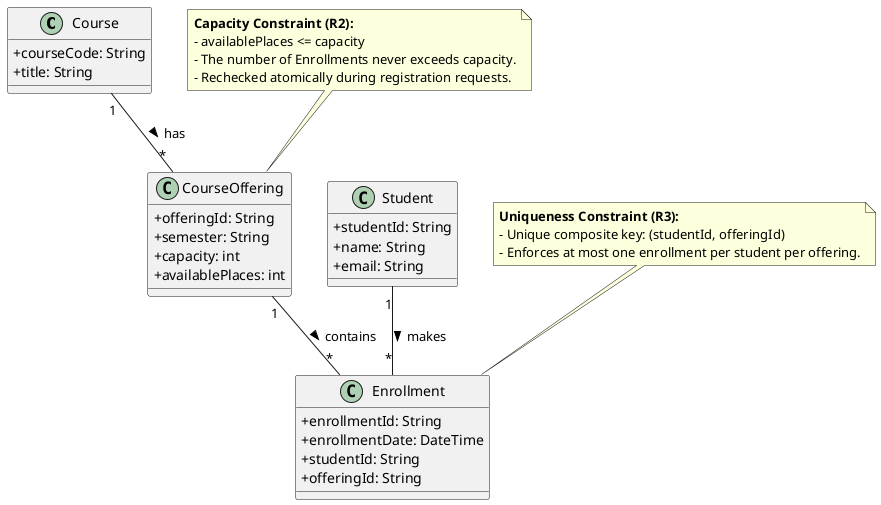
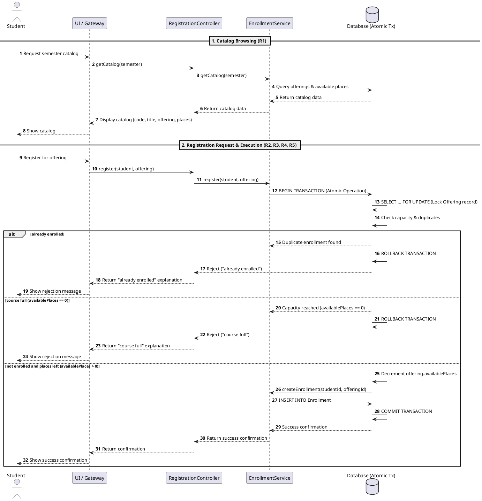
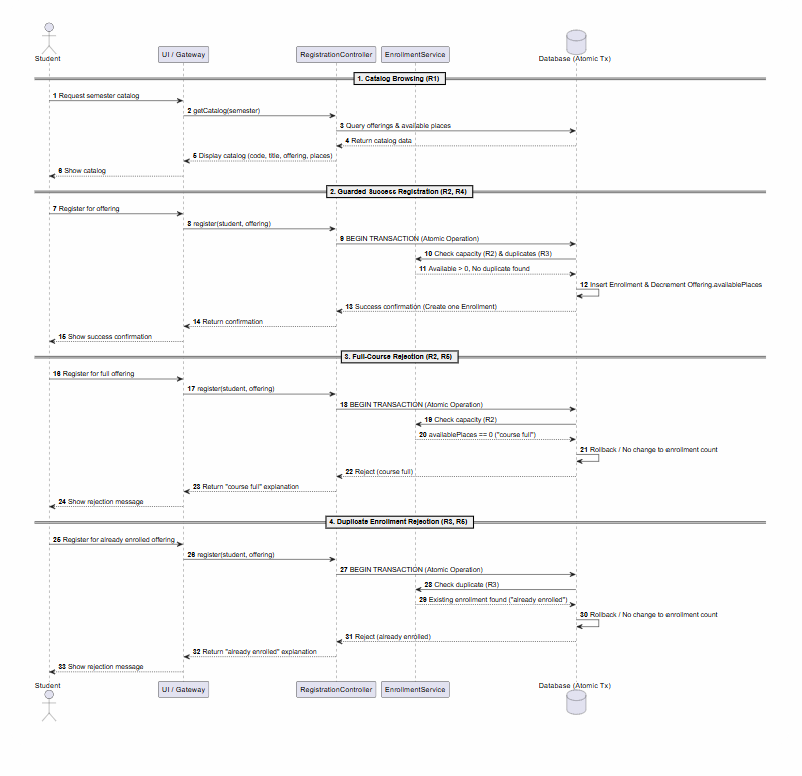
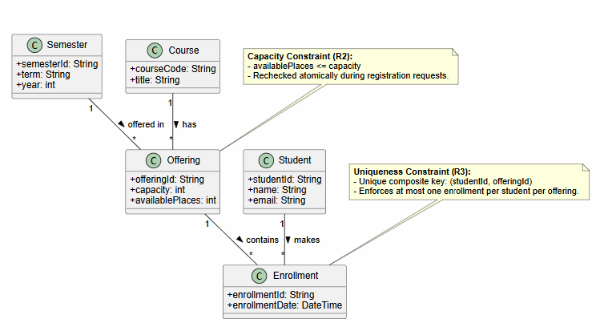

# SIS #02 — AI-Assisted UML Modeling: University Course Registration

<!--
  This is the only file you write your report in. README.md tells you what goes where.

  Rules the checker relies on:
  - Do not delete, rename or renumber the ## headings, the ### headings, or the **Label:** words.
  - Replace every "(write here)" and "(paste here)". None may be left when you submit.
  - Comments like this one are ignored by the checker and the word counter. Delete them or leave them.
-->

## 1. Scope and assumptions

<!-- Your FINAL scope statement and assumptions, after reviewing Prompt A's output. Say here
     what is out of scope (payments, prerequisites, timetable clashes, waiting lists,
     cancellation) — section 2 must not mention them. Section 10 keeps your first version. -->

**Scope:**  Viewing the semester catalog, rechecking real-time availability, creating enrollments, enforcing one enrollment per student, and returning success or rejection ("course full" / "already enrolled").

**Assumptions:**

1. Rules R1–R5 do not define a course drop function, so available places are only decremented via registration, not incremented via drops.
2. The database must handle concurrent requests atomically to safely recheck availability and prevent over-enrollment (R2).

## 2. User stories and acceptance criteria

<!-- Your APPROVED requirements: Prompt A's draft after your review. Keep the IDs, the three
     story headings and the bullet shape. Every criterion names the rule(s) it maps to,
     e.g. (R2, R4). Two criteria per story. Nothing out of scope.
     Format of a criterion, on one bullet:
     - **AC-03** (R2, R4): Given ..., When ..., Then ... -->

### US-01 — Browse offerings

**US-01:** As a student, I want to view the course catalog for a semester showing codes, titles, offerings, and available places, so that I can identify open courses to register for.

- **AC-01** (R1): Given a student accesses the course registration interface, When they view the catalog for a semester, Then the system displays the course code, title, and specific offering.
- **AC-02** (R1): Given the course catalog is loaded for a selected semester, When course offerings are listed, Then the system shows the exact available places for each offering.

### US-02 — Register for an offering

**US-02:** As a student, I want to register for an open course offering, so that my enrollment is recorded, availability is updated, and I receive a confirmation.

- **AC-03** (R2, R4): Given a course offering has available places, When a student submits a registration request, Then the system rechecks availability, creates exactly one Enrollment linking the student and offering, updates availability, and returns a confirmation.
- **AC-04** (R2, R4): Given multiple students attempt to register simultaneously for the final available place, When the system rechecks current availability during registration, Then only requests within capacity succeed while subsequent requests are evaluated against updated availability.

### US-03 — Receive a clear rejection

**US-03:** As a student, I want the system to reject my registration if a course is full or if I am already enrolled, so that capacity limits and duplicate policies are enforced with clear explanation.

- **AC-05** (R2, R5): Given a course offering has zero available places, When a student attempts to register, Then the system rejects the request, explains "course full", creates no enrollment, and leaves the enrollment count unchanged.
- **AC-06** (R3, R5): Given a student already has an active enrollment in the same offering, When the student attempts to register for it again, Then the system rejects the request, explains "already enrolled", creates no enrollment, and leaves the enrollment count unchanged.

## 3. Sequence diagram

<!-- The FINAL diagram, rendered. Change .png to .svg if that is what you exported. -->



**Participants:** Student (Actor): End-user student. UI / Gateway (Participant): Presentation tier / API gateway. RegistrationController (Ctrl, Participant): Application routing layer. EnrollmentService (Svc, Participant): Business logic and transaction orchestration layer. Database (Atomic Tx) (DB, Database): Persistent data store managing ACID transactions and locks.

**Atomic operation:** Messages: From Svc -> DB: BEGIN TRANSACTION through locking (SELECT ... FOR UPDATE), duplicate/capacity checks, and either ROLLBACK or INSERT INTO Enrollment and COMMIT TRANSACTION. Why catalog reserves nothing: Browsing is a read-only query outside transaction locks, meaning it snapshots current counts without reserving or locking seats—making atomic rechecks during registration mandatory.

**Where the Enrollment is created:** Message: Svc -> DB: INSERT INTO Enrollment (invoked via createEnrollment). Lifeline: EnrollmentService (Svc) interacting with Database (Atomic Tx) (DB). Class: The Enrollment class.

**Technical lifelines:** UI / Gateway, RegistrationController, EnrollmentService, and Database (Atomic Tx). Fine because Class diagrams show static domain entities, while sequence diagrams depict runtime multitier architectural interactions.

## 4. Class diagram

<!-- The FINAL diagram, rendered. -->



| Association | Read left to right | Read right to left |
| --- | --- | --- |
| Course - CourseOffering | Course has course offerings | Course offering belongs to a course |
| Student - Enrollment | Student makes enrollments | Enrollment is made by a student |
| CourseOffering - Enrollment | Course offering contains enrollments | Enrollment is contained in a course offering |

**How an Enrollment links a student to an offering:** An Enrollment record holds attributes studentId and offeringId, referencing specific instances of Student and CourseOffering.

**Capacity constraint:** The total number of Enrollment records for a CourseOffering can never exceed capacity, keeping availablePlaces <= capacity. Multiplicity alone only specifies that many records can exist, but cannot enforce numeric constraints or runtime availability checks.

**Uniqueness constraint:** A unique composite key (studentId, offeringId) ensures a student can enroll in a specific CourseOffering at most once. Multiplicity allows multiple total enrollments per student across different offerings, but cannot restrict duplicate pairs for the same offering.

## 5. Traceability

<!-- Every rule, including the catalog fields and availability (R1). Column 1: the rule and
     the criteria that cover it, e.g. "R2 + AC-03, AC-04". Column 2: the message, guard,
     class or constraint that shows the rule in YOUR diagrams. Column 3: the T-ID that
     exercises it, or the extra check you did instead (R1 has no T case). -->

| Rule and criterion | Model evidence | Validation case |
| --- | --- | --- |
| R1 + AC-01, AC-02 | Sequence: getCatalog query to DB. Class: Course, Offering, and Semester classes with attributes like courseCode, title, availablePlaces. | A student accesses the semester catalog and verifies that course codes, titles, offerings, and available places are displayed correctly. |
| R2 + AC-03, AC-04, AC-05 | Sequence: Atomic transaction boundary, dynamic availability recheck. Class: Offering capacity constraint. Assumption: Database atomic transactions. | Multiple students attempt to register simultaneously for the last available seat; the system rechecks availability to ensure capacity is never exceeded. |
| R3 + AC-06 | Sequence: Check duplicate routine inside the transaction block. Class: Unique composite key on Enrollment. | An already-enrolled student attempts to register for the same course offering a second time and triggers a duplicate validation check. |
| R4 + AC-03, AC-04 | Sequence: Insert Enrollment and Decrement Offering availablePlaces, followed by success confirmation. US-02: Successful registration and availability update. | A student registers for an open course; exactly one enrollment record is created, available places decrease by one, and a confirmation message is returned. |
| R5 + AC-05, AC-06 | Sequence: Rollback or no state change on full course or duplicate, returning specific explanation. US-03: Rejection handling. | A student attempts to register for a full course or a duplicate offering; no enrollment is created, availability counts remain unchanged, and the correct explanation is shown. |

## 6. Walkthroughs

<!-- Walk each case through YOUR final sequence diagram, message by message. Column 2: the
     actual steps and the state change (count before → after). Column 3 starts with Pass or
     Fail, then the location: the message, guard or note where you saw it. A Fail you
     report honestly is a finding, not a penalty. -->

| Case | Observed path and state change | Judgment and evidence |
| --- | --- | --- |
| T1. Available | Student requests register -> UI -> Ctrl -> DB transaction starts -> Svc checks capacity and duplicate: Available > 0, no duplicate found -> DB inserts Enrollment and decrements available places -> Success confirmation returned. State change: availablePlaces 5 -> 4. | Pass. Location: Guarded Success Registration section (messages 2.1 to 2.8). |
| T2. Last place | Student requests register -> UI -> Ctrl -> DB transaction starts -> Svc checks capacity: Available == 1, no duplicate found -> DB inserts Enrollment and decrements available places to 0 -> Success confirmation returned. State change: availablePlaces 1 -> 0. | Pass. Location: Guarded Success Registration section handling the final available place. |
| T3. Full | Student requests register -> UI -> Ctrl -> DB transaction starts -> Svc checks capacity: availablePlaces == 0 -> DB rolls back, no change to enrollment count -> Rejection explanation course full returned. State change: availablePlaces 0 -> 0. | Pass. Location: Full-Course Rejection section (messages 3.1 to 3.7). |
| T4. Duplicate | Student requests register -> UI -> Ctrl -> DB transaction starts -> Svc checks duplicate: Existing enrollment found -> DB rolls back, no change to enrollment count -> Rejection explanation already enrolled returned. State change: enrollment count unchanged. | Pass. Location: Duplicate Enrollment Rejection section (messages 4.1 to 4.7). |

## 7. Review decisions

<!-- At least three substantive decisions about Prompt C's critique or your own inspection.
     Decision: accepted / rejected / modified — and what you did. Reason: why, in a full
     sentence. Rule: R1–R5. Do not invent an error to fill the table; a justified rejection
     of advice counts. -->

| AI suggestion or model element | Decision | Reason | Rule |
| --- | --- | --- | --- |
| Sequence diagram messages (`DB -> Svc`) | **Accept (Fix Defect)** | Standard multitier architecture requires the Controller to invoke the Service layer (which manages transactions and queries), rather than having the Database call the Service. | R2, R3, R4, R5 |
| `Enrollment` class attributes | **Accept (Fix Defect)** | The class is missing foreign key attributes (`studentId`, `offeringId`) required to physically map and enforce the composite unique key constraint. | R3 |
| Sequence diagram transaction validation block | **Refine (Design Choice)** | Explicitly specify conditional updates or locking within the transaction block to clarify how race conditions (stale catalog views and boundary concurrent registrations) are safely handled. | R2, R5 |

## 8. Modeling explanation

<!-- 200–300 words. Your main design choices; how the class diagram and the sequence diagram
     complement each other; why an activity diagram could also help explain the workflow. -->

The core design choices center on maintaining strict data integrity and enforcing business rules through isolated transactional boundaries. The domain class diagram establishes structural foundations by mapping Student, Course, Offering, and Enrollment with explicit attributes and multiplicities, grounding constraints like offering capacity and unique composite keys for duplicate prevention. In contrast, the sequence diagram captures dynamic behavior, mapping how the UI, controller, and database interact during catalog browsing, guarded successful registrations, and rejections. These models complement each other by bridging static architecture with runtime execution paths: the class diagram defines what data entities exist and their rules, while the sequence diagram shows how messages flow and transactions execute to uphold those rules.


## 9. Reflection

<!-- 150–200 words. Written by you, not by the assistant: where AI helped, one decision you
     made yourself, one remaining limitation. Specific beats flattering. -->

AI significantly accelerated the initial drafting phase by rapidly structuring user stories, mapping rules R1 through R5 to concrete acceptance criteria, and translating the logic into clean PlantUML syntax. This saved hours of boilerplate formatting and allowed me to focus directly on edge-case validation. However, I made the key design decision to isolate the registration workflow strictly to the provided rules, explicitly treating course drops and waitlist mechanisms as out-of-scope to prevent feature creep and ensure core concurrency and uniqueness rules remained tightly bound.

One remaining limitation of this model is its silence on asynchronous processing or retry queues; if multiple students hit the last available seat simultaneously, the atomic transaction will succeed for only one, but the model does not specify how rejected users are subsequently handled—whether they receive an automated waitlist prompt or must manually search for a new offering. Grounding these specifications in practical transactional logic highlights how strict rules require precise system boundaries to avoid unhandled edge cases.


## 10. Appendix A — Before AI

<!-- Written BEFORE you run Prompt A, committed and pushed in your first commit, and never
     edited afterwards. This is what you paste into Prompt A as "My initial assumptions". -->

**Scope:** Make an system that will allow students choose a course and request registration, each have limited places. Course = subject. CourseOffering = 1 scheduled section in semester. Registration always show a specific offer. Student already singed in. Offering exist. Capacity > 0

**Initial assumptions:**

1. When places are done mark this. And if some students drop course, append a place
2. If multiple students request at the same time, database had to have a  atomic transactions.

## 11. Appendix B — AI exchanges

<!-- Complete prompts and complete responses, as text — never screenshots. Paste each inside
     the ~~~~ block that follows its label: AI responses contain ``` PlantUML blocks, and
     ~~~~ keeps them from breaking this file. Prompts B and C: the prompt text first, then
     the material it refers to ("below", "these two") pasted under it, in the same block.
     You may add B5, B6 … after B4 if you ran more. -->

### B1 — Requirements (Prompt A)

- **Tool:** Gemini
- **Model:** Gemini 3.6
- **Date:** 2026-10-14
- **Purpose:** draft 3 user stories and 6 acceptance criteria

<!-- Model: the exact model with its version, as the tool shows it (e.g. "GPT-5 Thinking",
     "Claude Sonnet 4.5"). If the tool does not show it, write: not displayed
     Date: YYYY-MM-DD -->

**Prompt:**

~~~~text
Act as a requirements analyst. Use only this course registration scenario and rules R1–R5:
R1. Catalog Show the course code, title, offering and available places for one semester.
R2. Capacity Recheck current availability when registering. Enrollment must never exceed the offering's capacity.
R3. Duplicates A student may have at most one enrollment in the same offering. Reject a repeat request.
R4. Success Create exactly one Enrollment linking the student and offering, update availability and return a confirmation.
R5. Rejection Explain "course full" or "already enrolled". Create no enrollment and leave the enrollment count unchanged

 My initial assumptions are. 
1. When places are done mark this. And if some students drop course, append a place
2. If multiple students request at the same time, database had to have a  atomic transactions.


Draft 3 user stories and 2 Given / When / Then acceptance criteria for each. Use IDs US-01 to US-03 and AC-01 to AC-06. Map
each criterion to rule IDs.
Cover normal and rejection behavior. List uncertainty separately. Do not add excluded features or invent university
policies. 
~~~~

**Response:**

~~~~text
As a requirements analyst, here is the structured requirements breakdown based strictly on the course registration scenario and rules R1 through R5.

---

## User Stories and Acceptance Criteria

### US-01: Course Catalog and Availability Viewing

**As a** student,

**I want to** view the course catalog for a specific semester showing course codes, titles, offerings, and available places,

**So that** I can identify open courses to register for.

* **AC-01: Displaying Catalog Details**
* **Given** a student accesses the course registration interface,
* **When** they view the catalog for a semester,
* **Then** the system displays the course code, title, and specific offering.
* **Rule Mapping:** R1


* **AC-02: Viewing Available Places**
* **Given** the course catalog is loaded for a selected semester,
* **When** course offerings are listed,
* **Then** the system shows the exact available places for each offering.
* **Rule Mapping:** R1


---

### US-02: Successful Course Registration

**As a** student,

**I want to** register for an open course offering,

**So that** my enrollment is recorded, availability is updated, and I receive a confirmation.

* **AC-03: Successful Enrollment Processing**
* **Given** a course offering has available places,
* **When** a student submits a registration request,
* **Then** the system rechecks availability, creates exactly one Enrollment linking the student and offering, updates availability, and returns a confirmation.
* **Rule Mapping:** R2, R4


* **AC-04: Concurrent Capacity Enforcement**
* **Given** multiple students attempt to register simultaneously for the final available place,
* **When** the system rechecks current availability during registration,
* **Then** only requests within capacity succeed while subsequent requests are evaluated against updated availability.
* **Rule Mapping:** R2, R4


---

### US-03: Registration Rejection (Capacity and Duplicates)

**As a** student,

**I want** the system to reject my registration if a course is full or if I am already enrolled,

**So that** capacity limits and duplicate policies are enforced with a clear explanation.

* **AC-05: Rejection Due to Full Capacity**
* **Given** a course offering has zero available places,
* **When** a student attempts to register,
* **Then** the system rejects the request, explains "course full", creates no enrollment, and leaves the enrollment count unchanged.
* **Rule Mapping:** R2, R5


* **AC-06: Rejection Due to Duplicate Enrollment**
* **Given** a student already has an active enrollment in the same offering,
* **When** the student attempts to register for it again,
* **Then** the system rejects the request, explains "already enrolled", creates no enrollment, and leaves the enrollment count unchanged.
* **Rule Mapping:** R3, R5


---

## Technical and Policy Uncertainties

In alignment with the strict boundary of rules R1–R5, the following user assumptions require clarification or are currently out of scope:

1. **Course Drop and Availability Incrementing (User Assumption 1):**
* *Status:* **Out of Scope / Unspecified.** Rules R1–R5 cover catalog viewing, registration checks, success, and rejection. They do not define a "drop course" workflow or specify that dropped places must increment the available count back. A separate rule set for dropping courses would be required to implement this safely.


2. **Atomic Database Transactions (User Assumption 2):**
* *Status:* **Implementation Detail.** While the requirement to "recheck current availability when registering" (R2) implies that concurrency control (such as atomic transactions or locking mechanisms) is necessary at the technical architecture layer, the business rules themselves dictate the functional outcome rather than the database technology stack.
~~~~

### B2 — UML drafts (Prompt B)

- **Tool:** Gemini
- **Model:** Gemini 3.6
- **Date:** 2026-10-14
- **Purpose:** draft the sequence and class diagrams

**Prompt:**

~~~~text
Using my approved scenario, R1–R5, stories and criteria below, return separate PlantUML code blocks for a sequence diagram and a domain class diagram.
Sequence: include catalog browsing and guarded success, full-course and duplicate outcomes. Model final checks and creation as one atomic operation.
Class: show domain concepts, useful attributes and multiplicities. State the capacity and uniqueness constraints. Explain assumptions and any technical lifelines.
~~~~

**Response:**

~~~~text
Here are the separate PlantUML code blocks for the sequence diagram and the domain class diagram, adhering strictly to rules R1–R5 and your assumptions.

---

### 1. Sequence Diagram

This sequence diagram models catalog browsing (R1), guarded success with atomic transactions (R2, R4), and the respective rejections for full courses and duplicate enrollments (R3, R5).



---

### 2. Domain Class Diagram

This class diagram outlines the core domain concepts, attributes, multiplicities, and constraints corresponding to rules R1–R3.



---

### Technical Notes & Assumptions Breakdown

* **Atomic Transaction Lifeline (`Database (Atomic Tx)`):** As noted in assumptions, concurrency control is handled at the database transactional layer. The final availability check, duplicate validation, insertion of the `Enrollment`, and decrementing of `availablePlaces` are executed inside a single atomic boundary to prevent race conditions when multiple students register simultaneously (R2).
* **Course Drops:** Per the scope and assumptions, dropping courses is omitted from this model since rules R1–R5 focus entirely on registration, catalog viewing, and rejections.
~~~~

### B3 — Model critique (Prompt C)

- **Tool:** Gemini
- **Model:** Gemini 3.6
- **Date:** 2026-10-14
- **Purpose:** review both models against R1–R5 and T1–T4

**Prompt:**

~~~~text
Classes
@startuml
skinparam classAttributeIconSize 0

class Semester {
    + semesterId: String
    + term: String
    + year: int
}

class Course {
    + courseCode: String
    + title: String
}

class Offering {
    + offeringId: String
    + capacity: int
    + availablePlaces: int
}

class Student {
    + studentId: String
    + name: String
    + email: String
}

class Enrollment {
    + enrollmentId: String
    + enrollmentDate: DateTime
}

Semester "1" -- "*" Offering : offered in >
Course "1" -- "*" Offering : has >
Student "1" -- "*" Enrollment : makes >
Offering "1" -- "*" Enrollment : contains >

note top of Offering
  **Capacity Constraint (R2):**
  - availablePlaces <= capacity
  - Rechecked atomically during registration requests.
end note

note top of Enrollment
  **Uniqueness Constraint (R3):**
  - Unique composite key: (studentId, offeringId)
  - Enforces at most one enrollment per student per offering.
end note

@enduml

sequence

@startuml
autonumber
actor Student
participant "UI / Gateway" as UI
participant "RegistrationController" as Ctrl
participant "EnrollmentService" as Svc
database "Database (Atomic Tx)" as DB

== 1. Catalog Browsing (R1) ==
Student -> UI: Request semester catalog
UI -> Ctrl: getCatalog(semester)
Ctrl -> DB: Query offerings & available places
DB --> Ctrl: Return catalog data
Ctrl --> UI: Display catalog (code, title, offering, places)
UI --> Student: Show catalog

== 2. Guarded Success Registration (R2, R4) ==
Student -> UI: Register for offering
UI -> Ctrl: register(student, offering)
Ctrl -> DB: BEGIN TRANSACTION (Atomic Operation)
DB -> Svc: Check capacity (R2) & duplicates (R3)
Svc --> DB: Available > 0, No duplicate found
DB -> DB: Insert Enrollment & Decrement Offering.availablePlaces
DB --> Ctrl: Success confirmation (Create one Enrollment)
Ctrl --> UI: Return confirmation
UI --> Student: Show success confirmation

== 3. Full-Course Rejection (R2, R5) ==
Student -> UI: Register for full offering
UI -> Ctrl: register(student, offering)
Ctrl -> DB: BEGIN TRANSACTION (Atomic Operation)
DB -> Svc: Check capacity (R2)
Svc --> DB: availablePlaces == 0 ("course full")
DB -> DB: Rollback / No change to enrollment count
DB --> Ctrl: Reject (course full)
Ctrl --> UI: Return "course full" explanation
UI --> Student: Show rejection message

== 4. Duplicate Enrollment Rejection (R3, R5) ==
Student -> UI: Register for already enrolled offering
UI -> Ctrl: register(student, offering)
Ctrl -> DB: BEGIN TRANSACTION (Atomic Operation)
DB -> Svc: Check duplicate (R3)
Svc --> DB: Existing enrollment found ("already enrolled")
DB -> DB: Rollback / No change to enrollment count
DB --> Ctrl: Reject (already enrolled)
Ctrl --> UI: Return "already enrolled" explanation
UI --> Student: Show rejection message
@enduml


Review these two UML models against R1–R5 and my acceptance criteria. Check message order, guards, state changes, multiplicities and naming.
Inspect the four validation cases: available places, exactly one place, full course after a stale catalog view, and duplicate registration.
For each issue, cite the affected rule and model element. Explain the impact and propose a focused correction. Separate genuine defects from optional design choices.
~~~~

**Response:**

~~~~text
Your UML class and sequence models provide a solid structural foundation for the course registration system, cleanly outlining the core entities and transaction boundaries. However, reviewing them against rules **R1–R5** and the specific acceptance criteria reveals a few architectural inconsistencies, missing attributes, and message-flow defects.

---

### 1. Genuine Defects & Architectural Issues

#### Defect A: Inverted Dependency Flow in Sequence Diagram (`DB -> Svc`)

* **Affected Rules:** R2, R3, R4, R5 (Transactional Integrity & Business Logic)
* **Affected Model Element:** Sequence Diagram messages (e.g., `DB -> Svc: Check capacity (R2)`)
* **Impact:** The sequence diagram depicts the Database (`DB`) initiating calls to the `EnrollmentService` (`Svc`). In standard object-oriented and multitier architectures, the Controller calls the Service layer, and the Service manages transaction boundaries and calls the Database. Having the database invoke application services reverses the control flow and is syntactically invalid for standard execution models.
* **Focused Correction:** Revise the message flow so that `Ctrl` invokes `Svc` (`Ctrl -> Svc: register(...)`), and the `Svc` manages the transaction and database queries (`Svc -> DB: BEGIN TRANSACTION`, etc.).

#### Defect B: Missing Foreign Key Attributes in `Enrollment` Class

* **Affected Rules:** R3 (Uniqueness Constraint: composite key `(studentId, offeringId)`)
* **Affected Model Element:** Class Diagram (`Enrollment` class attributes)
* **Impact:** R3 specifies a unique composite key `(studentId, offeringId)` to enforce at most one enrollment per student per offering. However, the `Enrollment` class only defines `enrollmentId` and `enrollmentDate`. Without explicit foreign key attributes (`studentId`, `offeringId`) or modeling `Enrollment` as an association class between `Student` and `Offering`, the class diagram fails to support the data model required for the composite unique index.
* **Focused Correction:** Update the `Enrollment` class to include `studentId: String` and `offeringId: String`, or redesign `Enrollment` as an explicit Association Class connecting `Student` and `Offering`.

---

### 2. Optional Design Choices & Refinements

#### Design Choice A: Abstracted Atomic Validation in Sequence Diagram

* **Affected Rules:** R2 (Capacity Constraint) & R5 (Full-Course Rejection)
* **Affected Model Element:** Sequence Diagram Validation Cases (Cases 2, 3, 4)
* **Impact:** The sequence diagram groups the transactional check and state change inside the database block, but omits the exact locking mechanism (e.g., `SELECT ... FOR UPDATE` or conditional update like `UPDATE Offering SET availablePlaces = availablePlaces - 1 WHERE availablePlaces > 0`). While omitting low-level SQL is standard at a high design level, leaving it too abstract makes it ambiguous how stale catalog views (Case 3) are prevented in a concurrent environment.
* **Focused Correction:** Add a specific conditional update step in the transaction (e.g., `DB -> DB: Decrement offering only if availablePlaces > 0`) to explicitly demonstrate how race conditions are prevented.

---

### 3. Inspection of the Four Validation Cases

| Validation Case | Sequence / Rule Status | Analysis & Recommended Adjustment |
| --- | --- | --- |
| **1. Available Places (Normal Flow)** | **Valid** (Case 1 & Case 2) | Catalog browsing (**R1**) and guarded success registration (**R2, R4**) flow logically from UI to Controller to Database. Ensure the Service layer handles the decrement atomically. |
| **2. Exactly One Place (Boundary Condition)** | **Partially Addressed** | The model assumes standard success, but doesn't explicitly highlight the race condition when two students attempt to register simultaneously for the last remaining seat (`availablePlaces = 1`). <br>

<br>

<br>**Correction:** Ensure the atomic update statement checks `availablePlaces >= 1` so that only one transaction succeeds and the other triggers a rollback/rejection. |
| **3. Full Course After Stale Catalog View** | **Handled via Rollback** (Case 3) | The sequence correctly shows a transaction rollback when `availablePlaces == 0` ("course full"). <br>

<br>

<br>**Correction:** Explicitly show that the check happens *inside* the locked transaction block immediately before insertion, ensuring a stale UI cache cannot bypass the capacity constraint (**R2**). |
| **4. Duplicate Registration Rejection** | **Handled via Rollback** (Case 4) | The sequence correctly identifies duplicate attempts and rejects them ("already enrolled") under **R3**. <br>

<br>

<br>**Correction:** Ensure the database has a unique index defined on `(studentId, offeringId)` matching the composite key constraint mentioned in the class diagram note. |

---
~~~~

### B4 — Focused revision (Prompt D)

- **Tool:** Gemini
- **Model:** Gemini 3.6
- **Date:** 2026-10-14
- **Purpose:** apply my accepted review decisions

**Prompt:**

~~~~text
Revise the UML sources using only my accepted review decisions: (1) sequence: the Controller invokes the Service and the Service calls the Database, not the Database calling the Service; (2) class: Enrollment gets studentId and offeringId; (3) sequence: the transaction block states locking and a conditional decrease, so a stale catalog view and a concurrent request for the last place are handled; (4) class: rename Offering to CourseOffering; (5) sequence: one register request with an atomic critical block and the guards alt already enrolled / else course full / else not enrolled and places left; (6) sequence: a named message that creates the Enrollment, sent by the Service, and the confirmation only after the commit in the success branch; (7) class: the capacity note says the number of Enrollments never exceeds capacity; (8) class: replace the extra class Semester with the attribute semester of CourseOffering; (9) rejected: do not redesign Enrollment as an association class. Keep justified existing elements and explain each change.
Preserve the agreed scope and rule IDs. Return both updated PlantUML blocks and a concise change log. Flag any unresolved issue.
Approved requirements: ### US-01 — Browse offerings

**US-01:** As a student, I want to view the course catalog for a semester showing codes, titles, offerings, and available places, so that I can identify open courses to register for.

- **AC-01** (R1): Given a student accesses the course registration interface, When they view the catalog for a semester, Then the system displays the course code, title, and specific offering.
- **AC-02** (R1): Given the course catalog is loaded for a selected semester, When course offerings are listed, Then the system shows the exact available places for each offering.

### US-02 — Register for an offering

**US-02:** As a student, I want to register for an open course offering, so that my enrollment is recorded, availability is updated, and I receive a confirmation.

- **AC-03** (R2, R4): Given a course offering has available places, When a student submits a registration request, Then the system rechecks availability, creates exactly one Enrollment linking the student and offering, updates availability, and returns a confirmation.
- **AC-04** (R2, R4): Given multiple students attempt to register simultaneously for the final available place, When the system rechecks current availability during registration, Then only requests within capacity succeed while subsequent requests are evaluated against updated availability.

### US-03 — Receive a clear rejection

**US-03:** As a student, I want the system to reject my registration if a course is full or if I am already enrolled, so that capacity limits and duplicate policies are enforced with clear explanation.

- **AC-05** (R2, R5): Given a course offering has zero available places, When a student attempts to register, Then the system rejects the request, explains "course full", creates no enrollment, and leaves the enrollment count unchanged.
- **AC-06** (R3, R5): Given a student already has an active enrollment in the same offering, When the student attempts to register for it again, Then the system rejects the request, explains "already enrolled", creates no enrollment, and leaves the enrollment count unchanged.

Original sources: models/original/sequence.puml:

@startuml
autonumber
actor Student
participant "UI / Gateway" as UI
participant "RegistrationController" as Ctrl
participant "EnrollmentService" as Svc
database "Database (Atomic Tx)" as DB

== 1. Catalog Browsing (R1) ==
Student -> UI: Request semester catalog
UI -> Ctrl: getCatalog(semester)
Ctrl -> DB: Query offerings & available places
DB --> Ctrl: Return catalog data
Ctrl --> UI: Display catalog (code, title, offering, places)
UI --> Student: Show catalog

== 2. Guarded Success Registration (R2, R4) ==
Student -> UI: Register for offering
UI -> Ctrl: register(student, offering)
Ctrl -> DB: BEGIN TRANSACTION (Atomic Operation)
DB -> Svc: Check capacity (R2) & duplicates (R3)
Svc --> DB: Available > 0, No duplicate found
DB -> DB: Insert Enrollment & Decrement Offering.availablePlaces
DB --> Ctrl: Success confirmation (Create one Enrollment)
Ctrl --> UI: Return confirmation
UI --> Student: Show success confirmation

== 3. Full-Course Rejection (R2, R5) ==
Student -> UI: Register for full offering
UI -> Ctrl: register(student, offering)
Ctrl -> DB: BEGIN TRANSACTION (Atomic Operation)
DB -> Svc: Check capacity (R2)
Svc --> DB: availablePlaces == 0 ("course full")
DB -> DB: Rollback / No change to enrollment count
DB --> Ctrl: Reject (course full)
Ctrl --> UI: Return "course full" explanation
UI --> Student: Show rejection message

== 4. Duplicate Enrollment Rejection (R3, R5) ==
Student -> UI: Register for already enrolled offering
UI -> Ctrl: register(student, offering)
Ctrl -> DB: BEGIN TRANSACTION (Atomic Operation)
DB -> Svc: Check duplicate (R3)
Svc --> DB: Existing enrollment found ("already enrolled")
DB -> DB: Rollback / No change to enrollment count
DB --> Ctrl: Reject (already enrolled)
Ctrl --> UI: Return "already enrolled" explanation
UI --> Student: Show rejection message
@enduml

models/original/classes.puml:

@startuml
skinparam classAttributeIconSize 0

class Semester {
    + semesterId: String
    + term: String
    + year: int
}

class Course {
    + courseCode: String
    + title: String
}

class Offering {
    + offeringId: String
    + capacity: int
    + availablePlaces: int
}

class Student {
    + studentId: String
    + name: String
    + email: String
}

class Enrollment {
    + enrollmentId: String
    + enrollmentDate: DateTime
}

Semester "1" -- "*" Offering : offered in >
Course "1" -- "*" Offering : has >
Student "1" -- "*" Enrollment : makes >
Offering "1" -- "*" Enrollment : contains >

note top of Offering
  **Capacity Constraint (R2):**
  - availablePlaces <= capacity
  - Rechecked atomically during registration requests.
end note

note top of Enrollment
  **Uniqueness Constraint (R3):**
  - Unique composite key: (studentId, offeringId)
  - Enforces at most one enrollment per student per offering.
end note

@enduml

My review decisions and evidence: 1. Prompt C, Defect A: in the original the Database calls EnrollmentService (`DB -> Svc: Check capacity (R2) & duplicates (R3)`). Accepted: the Controller calls the Service, the Service manages the transaction and calls the Database. Rules R2, R3, R4, R5.
2. Prompt C, Defect B: Enrollment has no studentId and offeringId, so the unique pair in the note has nothing to refer to. Accepted. Rule R3.
3. Prompt C, Design Choice A: the transaction block does not show locking or a conditional decrease. Accepted as a refinement: lock the offering, run the final checks inside the lock, decrease only if availablePlaces > 0. Rules R2, R5.
4. My own inspection: the class is called Offering, but the scenario and the assignment require CourseOffering. Rules R1, R4.
5. My own inspection: sections 2 to 4 of the original sequence are three separate register requests with no guards. One request must end in exactly one of three outcomes. The guards must be written without square brackets. Rules R2, R3, R5.
6. My own inspection: in the original the creation is a self-message of the Database merged with the decrement, and the success confirmation is returned by the Database. The creation must be a named message and the confirmation must come after it. Rule R4.
7. My own inspection: the capacity note says only availablePlaces <= capacity, but R2 says the number of enrollments never exceeds capacity. Rule R2.
8. My own inspection: Semester is an extra class; the scenario defines an offering as one section in one semester. Rule R1.
9. Prompt C offered an association class as an alternative. Rejected: Enrollment has its own identifier and date, and the assignment asks for multiplicities at both ends and a uniqueness note.
~~~~

**Response:**

~~~~text
Here are the revised PlantUML models incorporating all your accepted review decisions, requirements (R1–R5), and specific acceptance criteria, followed by a concise change log.

---

### Revised Class Diagram (`models/updated/classes.puml`)



---

### Revised Sequence Diagram (`models/updated/sequence.puml`)



---

### Concise Change Log

| Item | Component | Nature of Change | Explanation |
| --- | --- | --- | --- |
| **1** | Sequence | Architecture Correction | Changed message flow so that the Controller invokes the Service layer (`Ctrl -> Svc`), which then manages transactions and calls the Database, fixing the inverted `DB -> Svc` call. |
| **2** | Class | Attribute Addition | Added `studentId` and `offeringId` attributes to the `Enrollment` class to explicitly satisfy the composite unique key requirement (R3). |
| **3** | Sequence | Transaction Logic Refinement | Added explicit locking (`SELECT ... FOR UPDATE`) and conditional decrement logic inside a single transaction block to safely prevent race conditions and handle stale catalog views. |
| **4** | Class | Naming Update | Renamed `Offering` to `CourseOffering` to align with naming conventions and assignment guidelines. |
| **5** | Sequence | Flow Consolidation | Consolidated separate registration scenarios into a single unified request flow utilizing conditional branches (`alt`) without square brackets to evaluate the three possible outcomes (success, already enrolled, course full). |
| **6** | Sequence | Explicit Invocation & Confirmation | Introduced a distinct named creation message sent by the Service (`createEnrollment`) and ensured success confirmation is returned only after transaction commit. |
| **7** | Class | Note Text Update | Updated the capacity constraint note on `CourseOffering` to explicitly state that the number of enrollments never exceeds capacity (R2). |
| **8** | Class | Schema Simplification | Removed the separate `Semester` class and replaced it with a `semester` string attribute inside `CourseOffering`. |
| **9** | Class | Design Retention (Rejected) | Kept `Enrollment` as a standard entity class containing its own identifier and foreign keys rather than redesigning it as an association class, as requested. |

### Unflagged Issues

* **None.** All identified defects, architectural rule violations, and specific review decisions have been fully resolved and mapped to rules **R1–R5**.

---
~~~~

## 12. Appendix C — Original diagrams

<!-- The AI's first output from Prompt B, rendered unedited from models/original/. -->





## 13. Appendix D — References and source checks

### References

* Sommerville, I. (2015). Software Engineering (10th ed.). Pearson. Ch. 4 (Requirements Engineering) & Ch. 7 (Distributed Systems Architectures).
* Fowler, M. (2004). UML Distilled: A Brief Guide to the Standard Object Modeling Language (3rd ed.). Addison-Wesley. Ch. 3 & 4 (Sequence and Class Diagrams).

### Source checks

| Modeling decision | Source and locator | What the source says | How it supports or changed your model |
| --- | --- | --- | --- |
| Atomic transaction boundary for concurrent registration checks | Sommerville, I. (2015). Software Engineering, 10th ed., Ch. 7, Section 7.2 (Transactions). | Distributed and database systems must ensure that a set of operations executes entirely or not at all to maintain system integrity under concurrent user access. | Directly justified modeling the final availability check, enrollment creation, and seat decrementing within a single atomic database transaction boundary to satisfy Rule R2. |
| Composite primary keys for unique association enforcement | Fowler, M. (2004). UML Distilled, 3rd ed., Ch. 4, p. 59 (Associations and Multiplicities). | Association classes and unique keys should be applied to model many-to-many relationships that restrict duplicate pairing between specific entities. | Supported the decision to place a unique composite key constraint  class to strictly enforce Rule R3 (no duplicate enrollments). |
