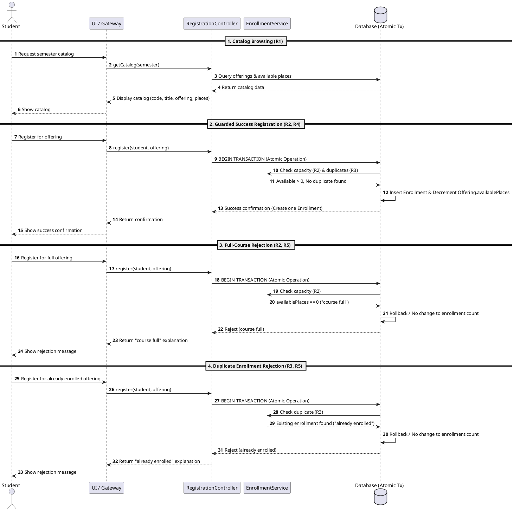
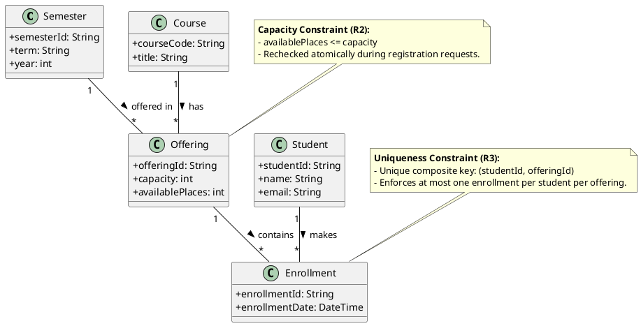

# SIS #02 — AI-Assisted UML Modeling: University Course Registration

<!--
  This is the only file you write your report in. README.md tells you what goes where.

  Rules the checker relies on:
  - Do not delete, rename or renumber the ## headings, the ### headings, or the **Label:** words.
  - Replace every "(write here)" and "(paste here)". None may be left when you submit.
  - Comments like this one are ignored by the checker and the word counter. Delete them or leave them.
-->

## 1. Scope and assumptions

<!-- Your FINAL scope statement and assumptions, after reviewing Prompt A's output. Say here
     what is out of scope (payments, prerequisites, timetable clashes, waiting lists,
     cancellation) — section 2 must not mention them. Section 10 keeps your first version. -->

**Scope:**  Viewing the semester catalog, rechecking real-time availability, creating enrollments, enforcing one enrollment per student, and returning success or rejection ("course full" / "already enrolled").

**Assumptions:**

1. Rules R1–R5 do not define a course drop function, so available places are only decremented via registration, not incremented via drops.
2. The database must handle concurrent requests atomically to safely recheck availability and prevent over-enrollment (R2).

## 2. User stories and acceptance criteria

<!-- Your APPROVED requirements: Prompt A's draft after your review. Keep the IDs, the three
     story headings and the bullet shape. Every criterion names the rule(s) it maps to,
     e.g. (R2, R4). Two criteria per story. Nothing out of scope.
     Format of a criterion, on one bullet:
     - **AC-03** (R2, R4): Given ..., When ..., Then ... -->

### US-01 — Browse offerings

**US-01:** As a student, I want to view the course catalog for a semester showing codes, titles, offerings, and available places, so that I can identify open courses to register for.

- **AC-01** (R1): Given a student accesses the course registration interface, When they view the catalog for a semester, Then the system displays the course code, title, and specific offering.
- **AC-02** (R1): Given the course catalog is loaded for a selected semester, When course offerings are listed, Then the system shows the exact available places for each offering.

### US-02 — Register for an offering

**US-02:** As a student, I want to register for an open course offering, so that my enrollment is recorded, availability is updated, and I receive a confirmation.

- **AC-03** (R2, R4): Given a course offering has available places, When a student submits a registration request, Then the system rechecks availability, creates exactly one Enrollment linking the student and offering, updates availability, and returns a confirmation.
- **AC-04** (R2, R4): Given multiple students attempt to register simultaneously for the final available place, When the system rechecks current availability during registration, Then only requests within capacity succeed while subsequent requests are evaluated against updated availability.

### US-03 — Receive a clear rejection

**US-03:** As a student, I want the system to reject my registration if a course is full or if I am already enrolled, so that capacity limits and duplicate policies are enforced with clear explanation.

- **AC-05** (R2, R5): Given a course offering has zero available places, When a student attempts to register, Then the system rejects the request, explains "course full", creates no enrollment, and leaves the enrollment count unchanged.
- **AC-06** (R3, R5): Given a student already has an active enrollment in the same offering, When the student attempts to register for it again, Then the system rejects the request, explains "already enrolled", creates no enrollment, and leaves the enrollment count unchanged.

## 3. Sequence diagram

<!-- The FINAL diagram, rendered. Change .png to .svg if that is what you exported. -->


**Participants:** (write here — each lifeline and what it stands for)

**Atomic operation:** (write here — which messages form the one atomic step: the final duplicate check, the capacity check and the creation of the Enrollment, and why a catalog view reserves nothing)

**Where the Enrollment is created:** (write here — which message, which lifeline, and which class in section 4 it produces)

**Technical lifelines:** (write here — every lifeline that is NOT a class in the class diagram, by name, and why the difference in abstraction is fine. "None" if there are none.)

## 4. Class diagram

<!-- The FINAL diagram, rendered. -->


<!-- One row per association in classes.puml, read in both directions. -->

| Association | Read left to right | Read right to left |
| --- | --- | --- |
| (write here) | (write here) | (write here) |
| (write here) | (write here) | (write here) |
| (write here) | (write here) | (write here) |

**How an Enrollment links a student to an offering:** (write here)

**Capacity constraint:** (write here — and why multiplicity alone cannot express it)

**Uniqueness constraint:** (write here — and why multiplicity alone cannot express it)

## 5. Traceability

<!-- Every rule, including the catalog fields and availability (R1). Column 1: the rule and
     the criteria that cover it, e.g. "R2 + AC-03, AC-04". Column 2: the message, guard,
     class or constraint that shows the rule in YOUR diagrams. Column 3: the T-ID that
     exercises it, or the extra check you did instead (R1 has no T case). -->

| Rule and criterion | Model evidence | Validation case |
| --- | --- | --- |
| R1 + (write here) | (write here) | (write here) |
| R2 + (write here) | (write here) | (write here) |
| R3 + (write here) | (write here) | (write here) |
| R4 + (write here) | (write here) | (write here) |
| R5 + (write here) | (write here) | (write here) |

## 6. Walkthroughs

<!-- Walk each case through YOUR final sequence diagram, message by message. Column 2: the
     actual steps and the state change (count before → after). Column 3 starts with Pass or
     Fail, then the location: the message, guard or note where you saw it. A Fail you
     report honestly is a finding, not a penalty. -->

| Case | Observed path and state change | Judgment and evidence |
| --- | --- | --- |
| T1. Available | (write here) | (write here) |
| T2. Last place | (write here) | (write here) |
| T3. Full | (write here) | (write here) |
| T4. Duplicate | (write here) | (write here) |

## 7. Review decisions

<!-- At least three substantive decisions about Prompt C's critique or your own inspection.
     Decision: accepted / rejected / modified — and what you did. Reason: why, in a full
     sentence. Rule: R1–R5. Do not invent an error to fill the table; a justified rejection
     of advice counts. -->

| AI suggestion or model element | Decision | Reason | Rule |
| --- | --- | --- | --- |
| (write here) | (write here) | (write here) | (write here) |
| (write here) | (write here) | (write here) | (write here) |
| (write here) | (write here) | (write here) | (write here) |

## 8. Modeling explanation

<!-- 200–300 words. Your main design choices; how the class diagram and the sequence diagram
     complement each other; why an activity diagram could also help explain the workflow. -->

(write here)

## 9. Reflection

<!-- 150–200 words. Written by you, not by the assistant: where AI helped, one decision you
     made yourself, one remaining limitation. Specific beats flattering. -->

(write here)

## 10. Appendix A — Before AI

<!-- Written BEFORE you run Prompt A, committed and pushed in your first commit, and never
     edited afterwards. This is what you paste into Prompt A as "My initial assumptions". -->

**Scope:** Make an system that will allow students choose a course and request registration, each have limited places. Course = subject. CourseOffering = 1 scheduled section in semester. Registration always show a specific offer. Student already singed in. Offering exist. Capacity > 0

**Initial assumptions:**

1. When places are done mark this. And if some students drop course, append a place
2. If multiple students request at the same time, database had to have a  atomic transactions.

## 11. Appendix B — AI exchanges

<!-- Complete prompts and complete responses, as text — never screenshots. Paste each inside
     the ~~~~ block that follows its label: AI responses contain ``` PlantUML blocks, and
     ~~~~ keeps them from breaking this file. Prompts B and C: the prompt text first, then
     the material it refers to ("below", "these two") pasted under it, in the same block.
     You may add B5, B6 … after B4 if you ran more. -->

### B1 — Requirements (Prompt A)

- **Tool:** Gemini
- **Model:** Gemini 3.6
- **Date:** 2026-10-14
- **Purpose:** draft 3 user stories and 6 acceptance criteria

<!-- Model: the exact model with its version, as the tool shows it (e.g. "GPT-5 Thinking",
     "Claude Sonnet 4.5"). If the tool does not show it, write: not displayed
     Date: YYYY-MM-DD -->

**Prompt:**

~~~~text
Act as a requirements analyst. Use only this course registration scenario and rules R1–R5:
R1. Catalog Show the course code, title, offering and available places for one semester.
R2. Capacity Recheck current availability when registering. Enrollment must never exceed the offering's capacity.
R3. Duplicates A student may have at most one enrollment in the same offering. Reject a repeat request.
R4. Success Create exactly one Enrollment linking the student and offering, update availability and return a confirmation.
R5. Rejection Explain "course full" or "already enrolled". Create no enrollment and leave the enrollment count unchanged

 My initial assumptions are. 
1. When places are done mark this. And if some students drop course, append a place
2. If multiple students request at the same time, database had to have a  atomic transactions.


Draft 3 user stories and 2 Given / When / Then acceptance criteria for each. Use IDs US-01 to US-03 and AC-01 to AC-06. Map
each criterion to rule IDs.
Cover normal and rejection behavior. List uncertainty separately. Do not add excluded features or invent university
policies. 
~~~~

**Response:**

~~~~text
As a requirements analyst, here is the structured requirements breakdown based strictly on the course registration scenario and rules R1 through R5.

---

## User Stories and Acceptance Criteria

### US-01: Course Catalog and Availability Viewing

**As a** student,

**I want to** view the course catalog for a specific semester showing course codes, titles, offerings, and available places,

**So that** I can identify open courses to register for.

* **AC-01: Displaying Catalog Details**
* **Given** a student accesses the course registration interface,
* **When** they view the catalog for a semester,
* **Then** the system displays the course code, title, and specific offering.
* **Rule Mapping:** R1


* **AC-02: Viewing Available Places**
* **Given** the course catalog is loaded for a selected semester,
* **When** course offerings are listed,
* **Then** the system shows the exact available places for each offering.
* **Rule Mapping:** R1


---

### US-02: Successful Course Registration

**As a** student,

**I want to** register for an open course offering,

**So that** my enrollment is recorded, availability is updated, and I receive a confirmation.

* **AC-03: Successful Enrollment Processing**
* **Given** a course offering has available places,
* **When** a student submits a registration request,
* **Then** the system rechecks availability, creates exactly one Enrollment linking the student and offering, updates availability, and returns a confirmation.
* **Rule Mapping:** R2, R4


* **AC-04: Concurrent Capacity Enforcement**
* **Given** multiple students attempt to register simultaneously for the final available place,
* **When** the system rechecks current availability during registration,
* **Then** only requests within capacity succeed while subsequent requests are evaluated against updated availability.
* **Rule Mapping:** R2, R4


---

### US-03: Registration Rejection (Capacity and Duplicates)

**As a** student,

**I want** the system to reject my registration if a course is full or if I am already enrolled,

**So that** capacity limits and duplicate policies are enforced with a clear explanation.

* **AC-05: Rejection Due to Full Capacity**
* **Given** a course offering has zero available places,
* **When** a student attempts to register,
* **Then** the system rejects the request, explains "course full", creates no enrollment, and leaves the enrollment count unchanged.
* **Rule Mapping:** R2, R5


* **AC-06: Rejection Due to Duplicate Enrollment**
* **Given** a student already has an active enrollment in the same offering,
* **When** the student attempts to register for it again,
* **Then** the system rejects the request, explains "already enrolled", creates no enrollment, and leaves the enrollment count unchanged.
* **Rule Mapping:** R3, R5


---

## Technical and Policy Uncertainties

In alignment with the strict boundary of rules R1–R5, the following user assumptions require clarification or are currently out of scope:

1. **Course Drop and Availability Incrementing (User Assumption 1):**
* *Status:* **Out of Scope / Unspecified.** Rules R1–R5 cover catalog viewing, registration checks, success, and rejection. They do not define a "drop course" workflow or specify that dropped places must increment the available count back. A separate rule set for dropping courses would be required to implement this safely.


2. **Atomic Database Transactions (User Assumption 2):**
* *Status:* **Implementation Detail.** While the requirement to "recheck current availability when registering" (R2) implies that concurrency control (such as atomic transactions or locking mechanisms) is necessary at the technical architecture layer, the business rules themselves dictate the functional outcome rather than the database technology stack.
~~~~

### B2 — UML drafts (Prompt B)

- **Tool:** Gemini
- **Model:** Gemini 3.6
- **Date:** 2026-10-14
- **Purpose:** draft the sequence and class diagrams

**Prompt:**

~~~~text
Using my approved scenario, R1–R5, stories and criteria below, return separate PlantUML code blocks for a sequence diagram and a domain class diagram.
Sequence: include catalog browsing and guarded success, full-course and duplicate outcomes. Model final checks and creation as one atomic operation.
Class: show domain concepts, useful attributes and multiplicities. State the capacity and uniqueness constraints. Explain assumptions and any technical lifelines.
~~~~

**Response:**

~~~~text
Here are the separate PlantUML code blocks for the sequence diagram and the domain class diagram, adhering strictly to rules R1–R5 and your assumptions.

---

### 1. Sequence Diagram

This sequence diagram models catalog browsing (R1), guarded success with atomic transactions (R2, R4), and the respective rejections for full courses and duplicate enrollments (R3, R5).



---

### 2. Domain Class Diagram

This class diagram outlines the core domain concepts, attributes, multiplicities, and constraints corresponding to rules R1–R3.



---

### Technical Notes & Assumptions Breakdown

* **Atomic Transaction Lifeline (`Database (Atomic Tx)`):** As noted in assumptions, concurrency control is handled at the database transactional layer. The final availability check, duplicate validation, insertion of the `Enrollment`, and decrementing of `availablePlaces` are executed inside a single atomic boundary to prevent race conditions when multiple students register simultaneously (R2).
* **Course Drops:** Per the scope and assumptions, dropping courses is omitted from this model since rules R1–R5 focus entirely on registration, catalog viewing, and rejections.
~~~~

### B3 — Model critique (Prompt C)

- **Tool:** (write here)
- **Model:** (write here)
- **Date:** (write here)
- **Purpose:** review both models against R1–R5 and T1–T4

**Prompt:**

~~~~text
(paste here)
~~~~

**Response:**

~~~~text
(paste here)
~~~~

### B4 — Focused revision (Prompt D)

- **Tool:** (write here)
- **Model:** (write here)
- **Date:** (write here)
- **Purpose:** apply my accepted review decisions

**Prompt:**

~~~~text
(paste here)
~~~~

**Response:**

~~~~text
(paste here)
~~~~

## 12. Appendix C — Original diagrams

<!-- The AI's first output from Prompt B, rendered unedited from models/original/. -->


## 13. Appendix D — References and source checks

### References

<!-- Full references, one per line, each starting with "- ". Only sources you actually opened.
     Every URL used in the source checks must also appear here. Example:
     - Sommerville, I. (2016). Software Engineering, 10th ed., Global Edition. Pearson. Ch. 5. -->

- (write here)

### Source checks

<!-- At least two modeling decisions you verified. Source and locator: title + slide, page,
     section, chapter or figure — or title + URL + access date (YYYY-MM-DD). Slide numbers
     refer to the decks posted in our Teams. -->

| Modeling decision | Source and locator | What the source says | How it supports or changed your model |
| --- | --- | --- | --- |
| (write here) | (write here) | (write here) | (write here) |
| (write here) | (write here) | (write here) | (write here) |
